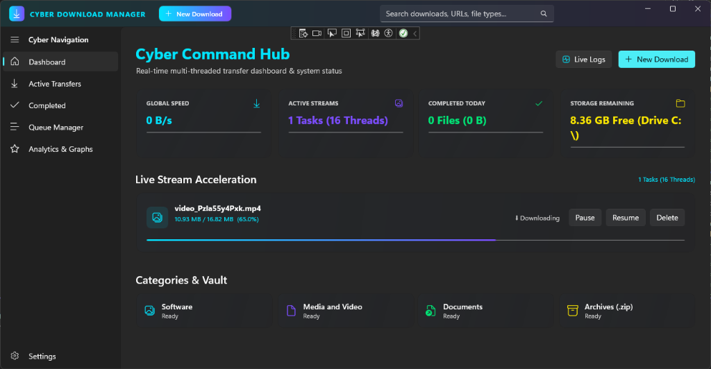
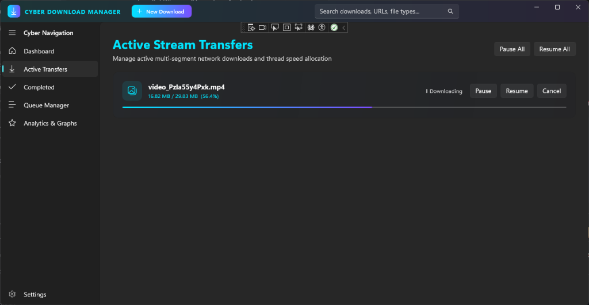

# Cyber Download Manager (CDM)

[](LICENSE)
[](https://dotnet.microsoft.com/)
[](https://learn.microsoft.com/en-us/windows/apps/winui/winui3/)
[](#architecture)
[-blue.svg)](#system-requirements)

---

## 📸 User Interface Showcase (Actual Running Application)

### 1. Cyber Command Hub (Dashboard)
> Real-time multi-threaded transfer telemetry, global throughput speed, active stream monitoring (16 Threads), storage metrics, live stream acceleration progress, and categorized vault.



---

### 2. Active Stream Transfers Hub
> Granular per-task stream acceleration, segmented download progress tracking, pause/resume/cancel controls, and thread speed allocation.



---

## 🇬🇧 English Overview

**Cyber Download Manager (CDM)** is a next-generation, high-performance desktop download manager and network transfer orchestrator engineered with **C#, .NET 9, and WinUI 3 (Windows App SDK)**. Designed using **Clean Architecture** and **Domain-Driven Design (DDD)** principles, CDM delivers multi-segmented dynamic thread acceleration (16 parallel threads), queue management, video downloading, and real-time telemetry.

### ⚡ Key Capabilities
* **Dynamic Multi-Thread Acceleration (16 Threads):** Automatically splits network streams into parallel chunks to maximize socket bandwidth utilization.
* **Resilient State Persistence:** Full pause, resume, and cancel capability with byte-range `Range: bytes=` support and transaction safety.
* **Modern Windows Desktop UI:** Sleek cyberpunk dark theme engineered with WinUI 3, Mica material, and smooth asynchronous updates.
* **Clean Architecture Design:** Strict segregation between Domain, Application, Infrastructure, Presentation (MVVM), and Shared layers.
* **Intelligent Queue & Storage Telemetry:** Real-time disk capacity monitoring, transfer categorization (Software, Media & Video, Documents, Archives), and priority scheduling.
* **Non-Blocking Asynchronous Engine:** High-performance async I/O (`async/await`) with low memory and CPU overhead.

### 🏗️ Architectural Topology
```
CyberDownloadManager/
├── src/
│   ├── CyberDownloadManager.Presentation/   # WinUI 3 Desktop App, MVVM ViewModels, Pages & XAML Views
│   ├── CyberDownloadManager.Domain/         # Core Entities, Enums, Value Objects & Repository Interfaces
│   ├── CyberDownloadManager.Application/    # Use Cases, DTOs, Download Engine Contracts & Services
│   ├── CyberDownloadManager.Infrastructure/ # Network Sockets, Multi-Thread Engine, Storage & Database
│   └── CyberDownloadManager.Shared/         # Cross-cutting constants, Result types & Utilities
├── tests/
│   ├── CyberDownloadManager.Application.Tests/  # Application services unit tests
│   ├── CyberDownloadManager.Domain.Tests/       # Domain business logic tests
│   └── CyberDownloadManager.Infrastructure.Tests/# Network engine & persistence tests
└── docs/
    └── screenshots/                         # Actual application UI captures
```

### 🚀 Getting Started

#### Prerequisites
* [.NET 9.0 SDK](https://dotnet.microsoft.com/download/dotnet/9.0)
* Windows App SDK / WinUI 3 runtime
* Windows 10 (version 1809+) or Windows 11 (x64)
* Visual Studio 2022 (v17.12+) with ".NET Desktop Development" workload

#### Build & Run
```bash
# 1. Clone the repository
git clone ssh://git@ssh.github.com:443/ebrahim-alazzani/CyberDownloadManager.git
cd CyberDownloadManager

# 2. Restore dependencies
dotnet restore

# 3. Build project for x64 architecture
dotnet build -p:Platform=x64 --configuration Release

# 4. Run application
dotnet run --project src/CyberDownloadManager.Presentation -p:Platform=x64
```

---

## 🇸🇦 نظرة عامة باللغة العربية

**Cyber Download Manager (CDM)** هو برنامج ومدير تنزيلات مكتبي متطور وعالي الأداء لنظام ويندوز، مبني باستخدام **C# و .NET 9 مع واجهات WinUI 3 (Windows App SDK)** الحديثة. تم تصميم البرنامج وفق معمارية **Clean Architecture** ومبادئ **التصميم الموجه بالمجال (DDD)** لتقديم تجربة تنزيل فائقة السرعة مع تسريع التنزيل عبر تقسيم الاتصال إلى مسارات متوازية (16 مسار/Thread)، وإدارة طوابير التنزيل، واستئناف التحميل عند انقطاع الإنترنت.

### ⚡ أبرز المميزات
* **تسريع ديناميكي متعدد المسارات (16 Threads):** تقسيم الملف إلى 16 مساراً متوازياً لتحقيق أقصى استغلال لسرعة الإنترنت.
* **استئناف التنزيل بأمان (Pause & Resume):** دعم كامل لإيقاف واستئناف التنزيل دون تلف الملفات بفضل التحقق الدقيق من أجزاء البايت (`Byte-Range Verification`).
* **واجهة مستخدم عصرية وأنيقة (WinUI 3):** تصميم داكن (Cyber Dark Theme) عالي الدقة وسلس الاستخدام.
* **تصميم معماري نظيف (Clean Architecture):** فصل كامل للمسؤوليات بين طبقات العرض (Presentation)، والتطبيق (Application)، والنواة (Domain)، والبنية التحتية (Infrastructure).
* **متابعة حية للمساحة والبيانات:** عرض المساحة المتبقية على القرص لحظياً، وتصنيف الملفات تلقائياً (برامج، وسائط وفيديو، وثائق، ملفات مضغوطة).
* **أداء فائق وخفيف على النظام:** استهلاك منخفض لمعالج الجهاز والذاكرة مع الاعتماد الكلي على البرمجة غير الحاجبة (`Async/Await`).

### 🏗️ هيكل الطبقات البرمجية
* **Presentation (WinUI 3):** واجهة المستخدم ونمط MVVM (شاشات Dashboard، التحميلات النشطة، الإعدادات).
* **Application:** منطق التنزيل والتحكم بالمسارات والتنسيق بين التنزيلات.
* **Domain:** الكيانات الأساسية (DownloadItem) وقواعد الأعمال والحالات.
* **Infrastructure:** محرك التنزيل الفعلي والتعامل مع الشبكة والتخزين.
* **Shared:** النتائج المشتركة (Result Pattern) والثوابت.

### 🚀 خطوات التشغيل
```bash
# استعادة الحزم
dotnet restore

# البناء لمعمارية x64
dotnet build -p:Platform=x64

# تشغيل البرنامج
dotnet run --project src/CyberDownloadManager.Presentation -p:Platform=x64
```

---

## 📜 الترخيص (License)
هذا المشروع مرخص بموجب رخصة **MIT License**.
