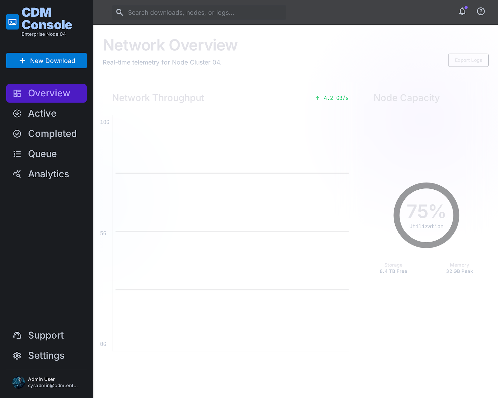
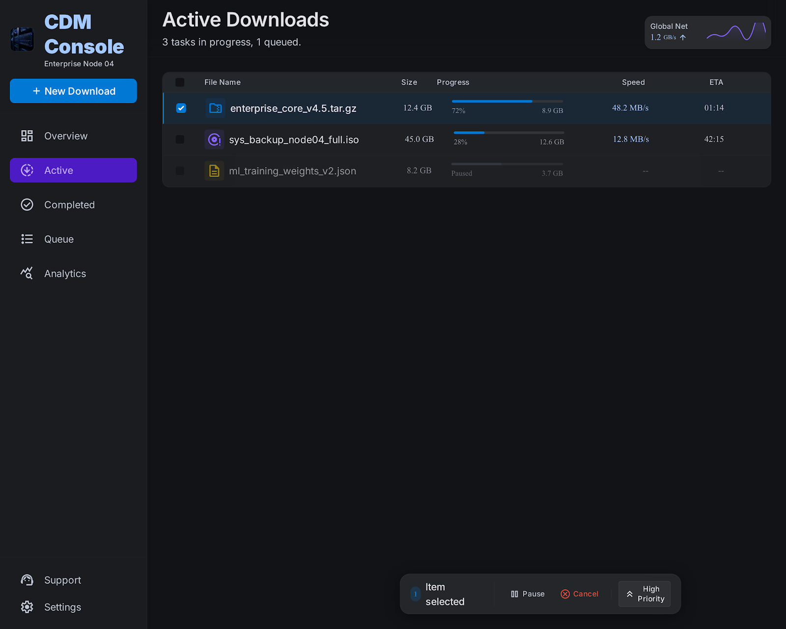
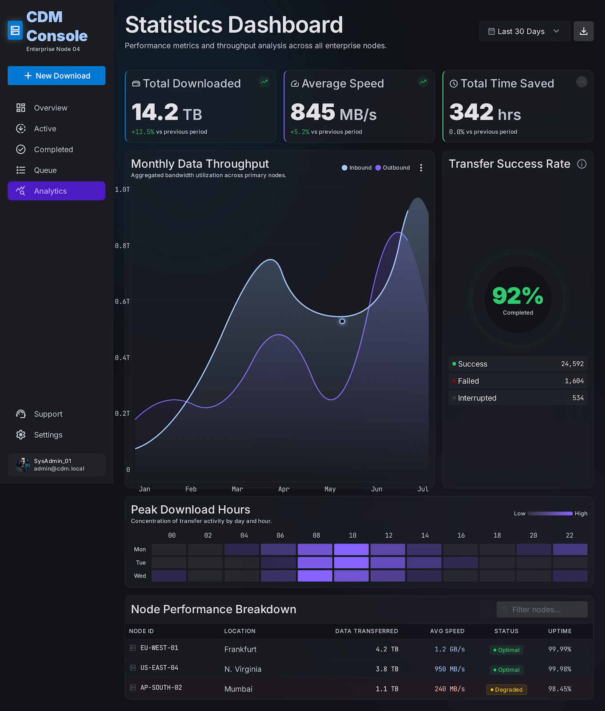
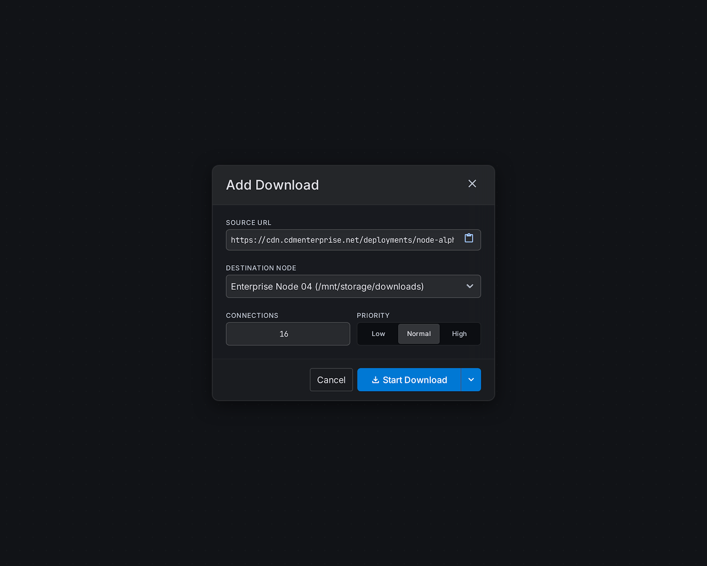
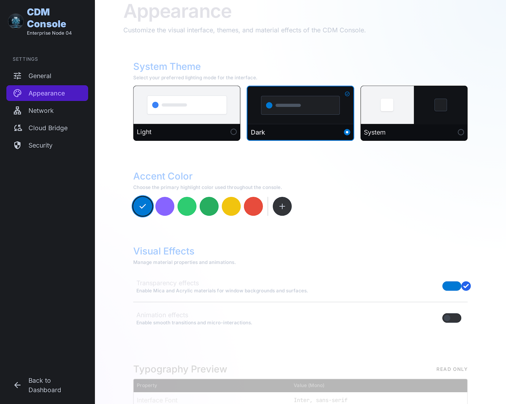

# Cyber Download Manager (CDM)

[](LICENSE)
[](https://dotnet.microsoft.com/)
[](#architecture)
[](#system-requirements)

**Cyber Download Manager (CDM)** is a next-generation, high-performance download accelerator and network transfer orchestrator engineered with **C# and .NET 9**. Designed from the ground up using **Clean Architecture** and **Domain-Driven Design (DDD)** principles, CDM delivers multi-segmented dynamic thread acceleration, intelligent bandwidth allocation, pause/resume fault-tolerance, and real-time telemetry.

---

## 📸 User Interface Showcase

### 1. Command Center & Telemetry Dashboard
> Real-time bandwidth telemetry, active queue prioritization, and aggregated throughput metrics.



---

### 2. High-Fidelity Active Transfers Hub
> Dynamic thread segmentation monitoring, byte-level verification, and per-task thread controllers.



---

### 3. Performance Intelligence & Bandwidth Analytics
> Deep network performance analytics, latency graphing, and hardware acceleration statistics.



---

### 4. New Download Task Configuration
> URL inspection, protocol validation, file type deduction, and immediate segmented scheduling.



---

### 5. Global Application Preferences
> Thread limits, proxy routing, bandwidth quotas, retry logic, and storage layout configurations.



---

## ⚡ Key Capabilities

* **Dynamic Multi-Thread Segmentation:** Automatically splits HTTP/HTTPS network streams into parallel chunks to maximize TCP socket saturation.
* **Resilient State Persistence:** Full pause and resume capability with byte-range `Range: bytes=` support and transaction safety.
* **Clean Architecture Design:** Strict segregation between Domain, Application, Infrastructure, and Presentation layers.
* **Intelligent Network Prioritization:** Granular bandwidth throttling and priority queue scheduler for concurrent downloads.
* **Deep Telemetry & Hardware Acceleration:** Real-time throughput calculation, network latency metrics, and hardware telemetry.
* **Silent Background Execution:** Minimized memory footprint, system tray synchronization, and non-blocking asynchronous I/O (`async/await`).

---

## 🏗️ Architectural Topology

The solution adheres strictly to **Clean Architecture** patterns:

```
CyberDownloadManager/
├── src/
│   ├── CyberDownloadManager.Domain/         # Core Entities, Value Objects, Domain Events & Interfaces
│   ├── CyberDownloadManager.Application/    # Use Cases, CQRS Handlers, Transfer Orchestrator & Services
│   ├── CyberDownloadManager.Infrastructure/ # Network Sockets, Multi-Thread Engine, Storage & Logging
│   ├── CyberDownloadManager.Presentation/   # Desktop GUI, ViewModels (MVVM) & User Interaction
│   └── CyberDownloadManager.Shared/         # Utilities, Common Contracts & Cross-Cutting Constants
├── tests/
│   ├── CyberDownloadManager.UnitTests/      # Engine unit tests & protocol verification
│   └── CyberDownloadManager.IntegrationTests/# End-to-end multi-thread transfer tests
└── docs/
    └── screenshots/                         # UI captures & architecture diagrams
```

---

## 🚀 Getting Started

### Prerequisites
* [.NET 9.0 SDK](https://dotnet.microsoft.com/download/dotnet/9.0) or higher.
* Visual Studio 2022 (v17.12+) or Visual Studio Code with C# Dev Kit.
* Windows 10 / Windows 11 (x64 / ARM64).

### Build & Run from Source

1. **Clone the repository:**
   ```bash
   git clone ssh://git@ssh.github.com:443/ebrahim-alazzani/CyberDownloadManager.git
   cd CyberDownloadManager
   ```

2. **Restore dependencies:**
   ```bash
   dotnet restore
   ```

3. **Build the solution:**
   ```bash
   dotnet build --configuration Release
   ```

4. **Launch Cyber Download Manager:**
   ```bash
   dotnet run --project src/CyberDownloadManager.Presentation
   ```

---

## 🧪 Running Tests

Validate core transfer mechanics and segmentation algorithms:
```bash
dotnet test --logger "console;verbosity=normal"
```

---

## 📜 License

This project is licensed under the **MIT License** - see the [LICENSE](LICENSE) file for details.
